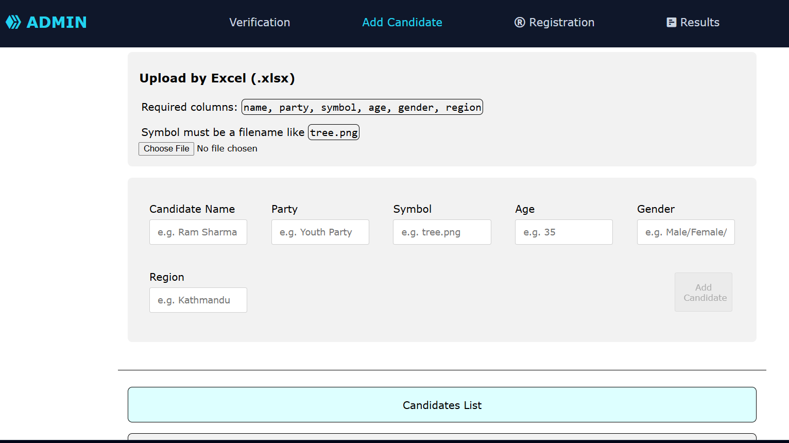
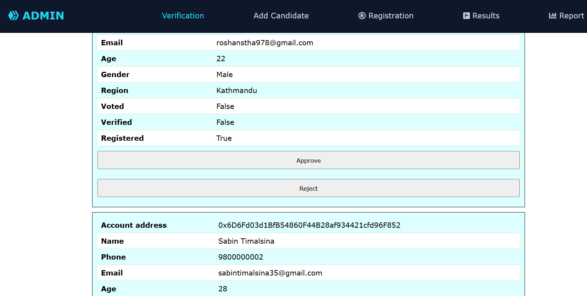
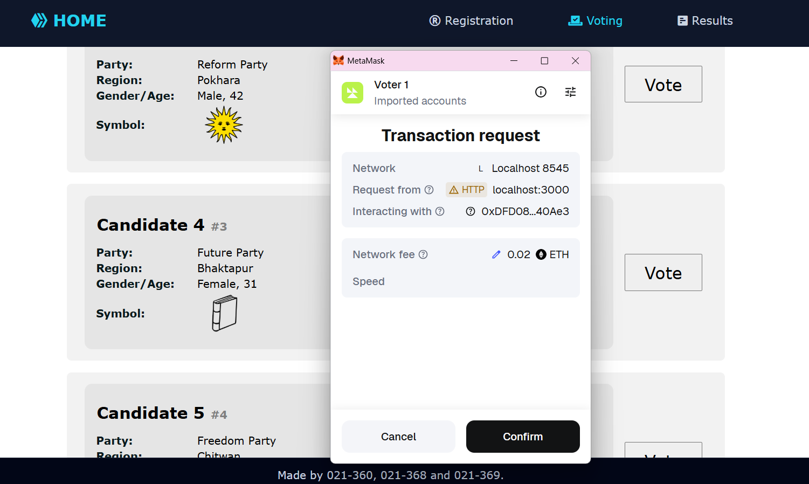
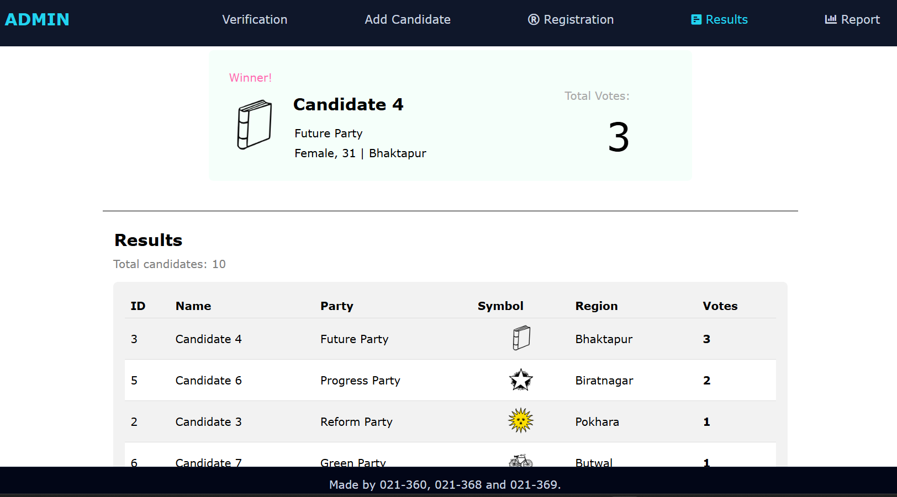
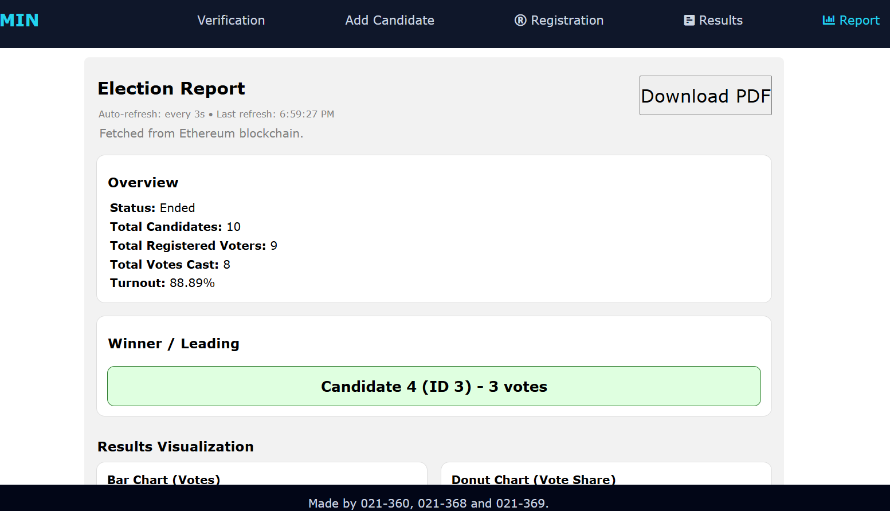
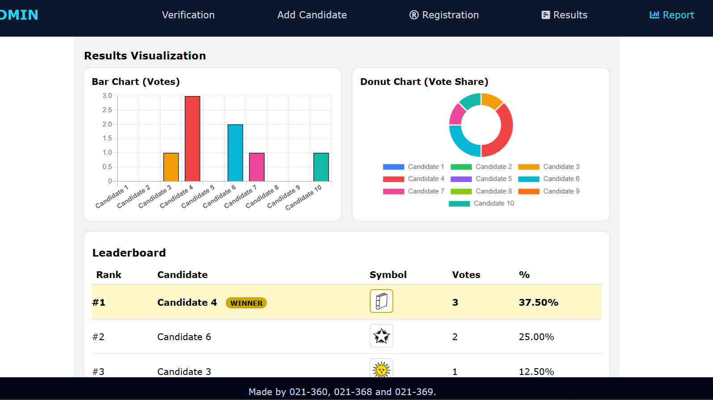
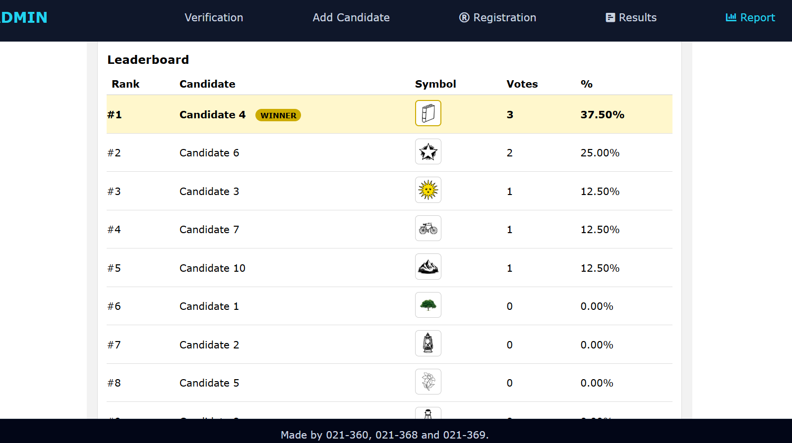
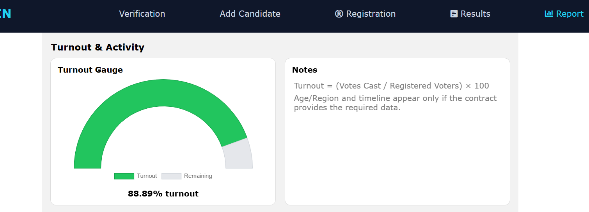

# DigiVote: Decentralized Online Voting on Ethereum

A voting system where the votes live on the Ethereum blockchain instead of in a database someone can quietly edit. An admin sets up the election, adds candidates and verifies voters; verified voters connect with MetaMask and cast exactly one vote; results and turnout analytics are read straight from the smart contract.

Built as my final year project in Computer Engineering.

## The Problem

Traditional online voting systems depend on a central server and whoever controls it:

- **Results can be altered:** an admin with database access can change vote counts without leaving a trace.
- **Double voting is hard to rule out:** enforcement lives in application code that voters can't inspect.
- **Low transparency:** voters have to trust the published result, with no way to check it themselves.

DigiVote moves the rules into a smart contract. "Only verified voters can vote", "one vote per voter" and "voting only while the election is open" are enforced by the contract itself, and every action is a public, permanent transaction.

## Features

- **Smart-contract election rules:** one vote per address, only verified voters, only while the election is active, only valid candidates; all checked on-chain with `require`
- **Role-based access:** admin-only actions (adding candidates, verifying voters, starting/ending the election) are protected by an `onlyAdmin` modifier
- **Voter registration and verification:** voters self-register with their wallet; the admin reviews and verifies them before they can vote
- **Bulk import from Excel/CSV:** admins can upload candidate and voter lists, which are sent to the contract in batched transactions instead of one transaction per row
- **Live results:** vote counts and the winner are read directly from the contract
- **Analytics report:** vote share, turnout gauge, votes by age group and region, and a voting timeline built from on-chain `VoteCast` events; printable as a PDF
- **Email notifications:** a Node.js service listens for `ElectionStarted` and `ElectionEnded` events over WebSocket and emails every registered voter automatically

## How It Works

```
Admin:   deploy contract → add candidates (form or Excel) → verify voters → start election → end election
Voter:   connect MetaMask → register → wait for verification → vote (one transaction) → view results
Events:  ElectionStarted / ElectionEnded → notifier (web3 WebSocket listener) → email to all voters
```

**Election lifecycle enforced by the contract:**

| State | `start` | `end` | What is allowed |
|---|:---:|:---:|---|
| Not started | false | false | Register, verify, add candidates |
| Active | true | false | Verified voters can vote once |
| Ended | false | true | View results and reports |

**Tech stack:** Solidity 0.8.20 · Truffle · Ganache · React · web3.js · MetaMask · Chart.js · SheetJS (xlsx) · Node.js · Nodemailer

## Quickstart

**Requirements:** Node.js, Truffle (`npm install -g truffle`), [Ganache](https://trufflesuite.com/ganache/), and the MetaMask browser extension.

**1. Start a local blockchain**

Open Ganache and start a workspace on `127.0.0.1:7545`.

**2. Deploy the contract**

```bash
git clone https://github.com/roshanstha01/decentralized-online-voting-system-using-ethereum.git
cd decentralized-online-voting-system-using-ethereum
truffle migrate --reset
```

The compiled contract (ABI and address) is written to `client/src/contracts/`, where the frontend and notifier read it.

**3. Connect MetaMask**

Add a network with RPC URL `http://127.0.0.1:7545` and chain ID `1337`, then import a few Ganache accounts using their private keys. The account that deployed the contract (the first Ganache account) is the admin.

**4. Run the frontend**

```bash
cd client
npm install
npm start
```

Open **http://localhost:3000**.

**5. (Optional) Run the email notifier**

Create `notifier/.env`:

```
RPC_WS=ws://127.0.0.1:7545
CONTRACT_ADDRESS=<deployed Election address>
EMAIL_HOST=smtp.gmail.com
EMAIL_PORT=465
EMAIL_SECURE=true
EMAIL_USER=<your email>
EMAIL_PASS=<app password>
FROM_NAME=DigiVote
```

```bash
cd notifier
npm install
npm start
```

## Screenshots

**Admin: adding candidates (form or Excel upload)**


**Admin: verifying registered voters**


**Voter: casting a vote through MetaMask**


**Results and winner**


**Analytics report: vote share, turnout, age and region breakdown**







